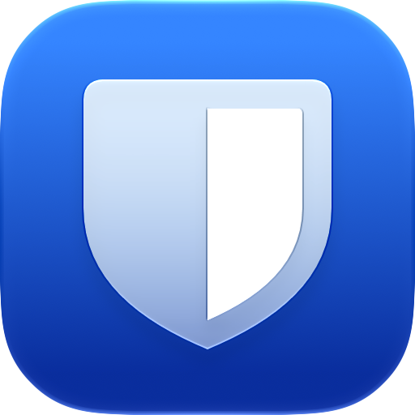

<p align="center">
  
</p>

<h1 align="center">Swiftwarden</h1>

<p align="center">
  A fast, native Bitwarden client for macOS, written in Swift and SwiftUI.<br>
  Autofill in any app, Touch ID unlock, and a 5 MB app with zero dependencies.
</p>

<p align="center">
  <a href="https://github.com/list-jonas/Swiftwarden/actions/workflows/ci.yml"></a>
  <a href="https://github.com/list-jonas/Swiftwarden/releases/latest"></a>
  
  
  <a href="LICENSE"></a>
</p>

---

Swiftwarden works with **bitwarden.com**, **bitwarden.eu** and **self-hosted** servers (official Bitwarden or Vaultwarden). It runs quietly in the menu bar, fills logins into browsers and native apps through the macOS Accessibility API, and keeps everything end-to-end encrypted exactly like the official clients.

## Install

### Homebrew

```sh
brew tap list-jonas/swiftwarden https://github.com/list-jonas/Swiftwarden
brew trust --tap list-jonas/swiftwarden
brew install --cask swiftwarden
```

Update with `brew upgrade --cask swiftwarden`. On Homebrew versions without `brew trust`, skip that line.

### Manual download

Grab `Swiftwarden-<version>.zip` from the [latest release](https://github.com/list-jonas/Swiftwarden/releases/latest), unzip it and move `Swiftwarden.app` to `/Applications`. The app is not signed with an Apple Developer ID, so remove the download quarantine once:

```sh
xattr -dr com.apple.quarantine /Applications/Swiftwarden.app
```

### First start

1. Log in with your server, email and master password.
2. Grant **Accessibility** access when asked (System Settings → Privacy & Security → Accessibility). Autofill needs it.
3. Optionally turn on Touch ID or a PIN in Settings → Security.

Swiftwarden adds itself as a login item and starts hidden in the menu bar. Closing the window keeps it running so autofill keeps working; quit with ⌘Q or from the menu bar.

## Features

| | |
|---|---|
| **Autofill everywhere** | A small panel offers matching logins when a username or password field gets focus in any app. Websites match by the browser's page URL, native apps by bundle id (`macapp://com.example.app`). ⇧⌘L opens a searchable quick-fill palette. Fills by typing, setting the value, or pasting. |
| **Unlock** | Master password, Touch ID (key sealed in the Secure Enclave), or PIN with an attempt limit. Auto-lock on idle, sleep or screen lock. |
| **Vault** | Logins, cards, identities, secure notes and SSH keys. Folders, favorites, organizations and collections, trash, custom fields, multiple URIs with match detection, password history, master password re-prompt, attachments, per-item cipher keys. |
| **Accounts** | PBKDF2 and Argon2id, two-step login (authenticator, email, YubiKey OTP), new-device verification, API key login, account creation. |
| **TOTP** | Live codes with countdown ring, `otpauth://` and Steam keys, copied automatically after autofill. |
| **Security report** | Weak, reused, insecure-URL and exposed passwords (Have I Been Pwned, k-anonymity). |
| **Generator** | Passwords, passphrases (EFF wordlist), usernames and forwarded email aliases (addy.io, SimpleLogin, DuckDuckGo, Firefox Relay, Forward Email). |
| **Send** | Text and file Sends with expiry, access limits and passwords. |
| **Import / export** | Bitwarden JSON (plain and password protected), CSV, and CSV from Chrome, Edge, Firefox, Safari, 1Password and others. |
| **Menu bar** | Search, copy username, password or code, generate a password, lock. |

## Security

- All cryptography is implemented with CommonCrypto, CryptoKit and Security.framework: AES-CBC + HMAC, RSA-OAEP, PBKDF2, HKDF and a pure-Swift Argon2id verified against RFC 9106.
- Your master password and decrypted vault never leave the device. The local sync cache stays encrypted with your vault keys, exactly as the server sends it.
- Secrets are stored in the macOS Keychain with `WhenUnlockedThisDeviceOnly`. Touch ID unlock wraps the key with a Secure Enclave key bound to the current biometric set.
- Autofill verifies the code signature of browsers before trusting the page URL they report.
- No telemetry and no third-party code.

Found a vulnerability? Please open a [private security advisory](https://github.com/list-jonas/Swiftwarden/security/advisories/new) instead of a public issue.

## Build from source

Requires Xcode 26 or later and [XcodeGen](https://github.com/yonaskolb/XcodeGen) (`brew install xcodegen`).

```sh
git clone https://github.com/list-jonas/Swiftwarden.git
cd Swiftwarden
scripts/install.sh     # Release build → /Applications/Swiftwarden.app, then starts it
```

| Script | What it does |
|---|---|
| `scripts/install.sh` | Builds Release, installs to `/Applications` and launches it |
| `scripts/dev.sh` | Builds and runs **Swiftwarden Dev** next to your installed app |
| `scripts/build.sh [Release\|Debug]` | Builds into `dist/` |

To work in Xcode, run `xcodegen generate` and open `Swiftwarden.xcodeproj`.

### Dev app

The Debug configuration builds a separate app, **Swiftwarden Dev**: its own bundle id (`com.listjonas.swiftwarden.dev`), settings, keychain items and data folder, an orange icon, a hammer menu bar icon and ⌥⌘L as the quick-fill shortcut. Your everyday install stays untouched while you work on the code.

Local builds are ad-hoc signed, so macOS asks for Accessibility and Keychain access again after each reinstall.

### Project layout

```
Core/                     Swift package, no UI
  Sources/SwiftwardenCore/
    Crypto/               EncString, AES/HMAC, RSA, KDFs, Argon2id
    API/                  server environments, HTTP client, token refresh
    Vault/                models, sync, TOTP, generator, import/export, URL matching
  Tests/                  unit and integration tests
App/
  Sources/App/            entry point, app state, lock, storage, preferences
  Sources/Views/          SwiftUI screens
  Sources/Autofill/       Accessibility observer, panels, hotkey, fill methods
  Resources/              Liquid Glass icons (AppIcon.icon, AppIconDev.icon)
Casks/                    Homebrew cask
```

### Tests

```sh
cd Core && swift test
```

Unit tests cover BLAKE2b, Argon2id, PBKDF2, EncString, RSA, TOTP, the generator, strength scoring, URL matching, CSV parsing and encrypted export. Integration tests run against a throwaway Vaultwarden and are skipped unless their environment variables are set:

```sh
docker run -d --name vw -e SIGNUPS_ALLOWED=true -p 8787:80 vaultwarden/server
cd Core
SW_IT_EMAIL=it@test.local SW_IT_PASSWORD='Integration-Pass-123!' SW_IT_PHASE=1 swift test --filter IntegrationTests
SW_IT_EMAIL=it@test.local SW_IT_PASSWORD='Integration-Pass-123!' SW_IT_PHASE=2 swift test --filter IntegrationTests
SW_SEED_EMAIL=demo@test.local SW_SEED_PASSWORD='Demo-Password-123!' swift test --filter 'SeedTests|OrgTests'
```

## Releases

CI builds and tests every push and pull request and attaches the app as a build artifact. Pushing a version tag publishes a release and updates the Homebrew cask:

```sh
git tag v0.2.0 && git push origin v0.2.0
```

## Not supported yet

- Duo and FIDO2/WebAuthn two-step login (use authenticator, email or API key login)
- SSO, trusted devices and Key Connector
- Creating passkeys and the system AutoFill credential provider
- Several accounts at once
- Bitwarden's SSH agent

## Contributing

Issues and pull requests are welcome. Keep the app dependency-free, run `swift test` in `Core`, and use the dev app for manual testing.

## License

[GPL-3.0](LICENSE). You are free to use, fork and modify Swiftwarden. If you distribute a modified version, it has to stay open source under the same license.

Swiftwarden is an independent project and is not affiliated with or endorsed by Bitwarden Inc. Bitwarden is a trademark of Bitwarden Inc.
